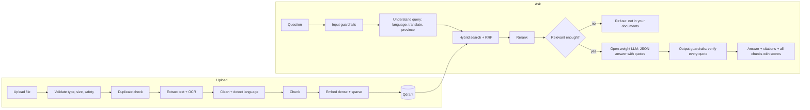

# Design Plan: Multilingual RAG Chatbot over Your Own Documents

**Portfolio Project 1 · Production RAG Service**
**Plan date:** 22 Nov 2026 · **Deadline:** 25 Nov 2026
**Full technical blueprint:** `PROJECT_BLUEPRINT.md` (this plan summarises its decisions)

---

## 1. What I am building

A chatbot where a user **uploads their own documents** (PDF, DOCX, PPTX, HTML, TXT, Markdown and images) and **asks questions about them** in **English, Urdu or Roman Urdu**. Every answer:
- comes only from the uploaded documents;
- cites the exact passage it used;
- shows every retrieved chunk with its similarity score;
- says clearly "I can't answer that from your documents" when the answer isn't there.

**Domain for the demo and evaluation:** a helpdesk for Pakistani citizen services and rights. Topics include ID cards, passports, the Sehat card, basic tax, complaints, and Punjab and Sindh consumer and driving-licence rules.

**Two layers of documents:**
- A seeded corpus of **official public documents**, which every user can search.
- **Private uploads**, visible only to the user who uploaded them. A legal-aid worker, for example, can add local notices.

**Constraints that shape every decision:**

| Constraint | Effect on the design |
|---|---|
| **Open-weight models only** (no proprietary LLM APIs) | Answers come from open models reached through the AntSeed network, with a local fallback |
| **Three languages**, including Roman Urdu, which has no standard spelling | A multilingual embedding model; questions are rewritten into English and Urdu script before search |
| **One RTX 3050 laptop GPU (6 GB)** | Small local models only (embedder, reranker, safety classifier); the large LLM runs remotely |
| **Code only**: LangChain/LangGraph allowed; Flowise, Langflow and Dify not allowed | FastAPI + LangGraph, all in Python |
| **3 days** | A fixed contract first, then parallel work, with the evaluation built early |

---

## 2. The pipeline at a glance

---

## 3. Every decision, from upload to answer

Each decision has the same three parts: **what I chose**, **why it is the best option here**, and **what I rejected**. Numbers marked *target* are hypotheses until the evaluation measures them.

### 3.1 Backend and orchestration

- **Chosen:** **FastAPI** (async, automatic OpenAPI/Swagger docs, Pydantic validation) with **LangGraph** for the question pipeline and **LangChain** for model clients.
- **Why:**
  - FastAPI's async model suits a service that mostly waits on the network: the LLM, the vector database, the GPU worker.
  - LangGraph makes each step a typed node with explicit branches for refuse, block, retry and fallback. That makes the logic visible, testable, and traced step by step in Langfuse.
- **Rejected:**
  - **Flask / Django:** no native async request handling and no built-in schema validation.
  - **A plain chain of functions:** the refusal and fallback branches turn into nested `if`s.
  - **Flowise, Langflow, Dify:** not allowed by the brief, and they hide the decisions this project has to justify.

### 3.2 Uploading and validating files

- **Chosen:**
  - **Allowed types:** PDF, DOCX, PPTX, HTML, TXT, MD, JPG and PNG. The extension **and** the file's magic bytes must agree.
  - **Size:** checked while streaming. Up to 10 MB is processed immediately (**201**); up to 50 MB is processed in the background (**202**, with progress); anything larger is rejected (**413**).
  - **Rejected as unsafe:** zip bombs, macros, PDF JavaScript and encrypted files.
- **Why:** user uploads are untrusted input. Checking magic bytes stops a renamed `.exe`. Background processing keeps the API responsive for large files.
- **Rejected:**
  - **Trusting the file extension:** easy to spoof.
  - **Processing everything synchronously:** large files time out.
  - **Unlimited sizes:** an easy way to run out of memory or overload the service.

### 3.3 Duplicate detection and document identity

- **Chosen:** three hashes.
  - The **file hash** catches an exact re-upload → 409 `duplicate_document`.
  - The **text hash** catches the same content in a different file, such as a re-exported PDF → 409 `duplicate_content`.
  - A **hash per chunk** drives incremental updates.

  Each chunk's ID is derived deterministically from the document ID, the chunk hash and its position.
- **Why:** deterministic IDs make re-ingestion **idempotent**, meaning re-running it changes nothing. A database unique constraint settles two identical uploads at the same moment: exactly one succeeds.
- **Rejected:**
  - **File-name matching:** the same name with new content is a common real case, such as a revised fee notice.
  - **Random chunk IDs:** every update would have to delete and re-insert everything.

### 3.4 Text extraction (including OCR)

- **Chosen:**
  - **PDF: PyMuPDF.** It extracts text per page and detects tables. Its font metadata also lets me remove **hidden white or 1-pt text**, a common injection trick.
  - **HTML: trafilatura**, which keeps the main content and drops menus and footers.
  - **DOCX / PPTX:** python-docx and python-pptx.
  - **OCR: Tesseract (`eng+urd`)**, run on the **rendered page**.
  - **A text-quality check on every page:** the share of characters in the expected script, and a dictionary hit rate. Pages that fail are re-done with OCR.
- **Why this matters:**
  - Checking real government PDFs showed that Urdu often "extracts" as **junk Latin characters or scrambled letters**, which looks like success but isn't.
  - Some Urdu brochures draw their text as **vector shapes**, so only OCR on the rendered page can read them.
  - Checking only "is there any text?" would put junk into the index.
- **Rejected:**
  - **pdfplumber:** good tables, but about 10× slower.
  - **unstructured:** heavy and slow to start.
  - **docling:** excellent layout analysis, but heavy. It's the upgrade path if table questions fail.
  - **Hand-written HTML rules:** brittle across a dozen site templates.

### 3.5 Cleaning, language detection and metadata

- **Chosen:**
  - **Cleaning:** remove repeated headers and footers.
  - **Text normalisation:** Unicode NFKC, Urdu digits mapped to Western digits, Urdu character variants unified.
  - **Language:** fastText language detection per chunk.
  - **Metadata per chunk:**
    - agency;
    - province / federal;
    - **document date**, read from inside the document: a "Date of issue" header beats the website's listing date;
    - page and section path;
    - flags for table, OCR and injection.
- **Why:** answers in this domain depend on **who** issued a rule, **where** it applies and **when** it was issued. Without these fields, the system can't tell a superseded fee notice from the current one, or Punjab's rule from Sindh's.
- **Rejected:**
  - **Storing text only:** filtering is impossible, and so is a "newest source wins" rule.
  - **Trusting website listing dates:** a real example was wrong by more than a year.

### 3.6 Chunking strategy

- **Chosen:**
  - **Structure-aware recursive splitting:** split at headings, slides and pages first, then paragraph → sentence → word.
  - **Size:** a target of **512 tokens with 64 overlap**, counted with the embedding model's own tokenizer.
  - **Urdu separators:** `۔` `؟` `،` are included.
  - **Tables are kept whole.** A table too long for one chunk is split by rows, with the header row repeated.
  - **Context header:** each chunk is embedded with a short header, `{agency} › {document} › {section}`, while the text shown to users stays clean.
- **Why:**
  - One idea per chunk gives better retrieval precision and cleaner citations.
  - Counting tokens rather than characters stops Urdu chunks from silently overflowing.
  - The header gives a short chunk like "Urgent: Rs …" the context it needs to be found.
- **Rejected:**
  - **Fixed character windows:** they cut sentences and tables. Kept as the **baseline** to beat.
  - **Semantic chunking:** slow, with boundaries that change between runs.
  - **One chunk per page:** too coarse.
- **Measured, not assumed:** configurations R1–R4 compare 256, 512 and 1024 tokens against the fixed baseline, and the numbers pick the winner (§4.4).

### 3.7 Embedding model

- **Chosen:** **BAAI/bge-m3**, run **locally on the GPU** (fp16, about 1.1 GB of VRAM).
  - In one pass it produces a 1024-dimension **dense** vector and **sparse** keyword weights.
  - It covers 100+ languages, including Urdu, and accepts up to 8k input tokens.
  - MIT licence.
- **Why it is the best fit:**
  1. **Cross-lingual retrieval works out of the box:** an Urdu question lands near the matching English passage.
  2. **Dense and sparse from one model** means hybrid search without a BM25 tokenizer, which handles Urdu badly.
  3. **Local and free:** documents never leave the machine for embedding.
  4. **It fits the 6 GB GPU** alongside the reranker.
- **Roman Urdu caveat:** no embedding model is trained much on Roman Urdu. The query is therefore also rewritten into English and Urdu script before search (§3.10).
- **Rejected:**
  - **multilingual-e5-large:** a strong dense model, but with no sparse output. Kept as comparison configuration R7.
  - **OpenAI / Cohere embedding APIs:** not open-source, they send documents to a vendor, and they cost money.
  - **Classic BM25 alone:** breaks on Urdu word forms.

### 3.8 Vector database

- **Chosen:** **Qdrant**, run in Docker locally, with a free cloud tier as an option.
  - One collection, holding both the dense and the sparse vectors for each chunk.
  - Indexes on owner, agency, province, language and document date.
- **Why:**
  - **Hybrid search is built in:** it searches dense and sparse vectors and fuses the results on the server.
  - **Strong metadata filtering:** filters by province, agency and document date.
  - **A special index for multi-user data**, which keeps each user's points grouped for filtered search.
  - **Upsert with deterministic IDs**, so updates replace points instead of piling up.
  - **Delete-by-filter that waits for completion**, so a deleted document is truly gone before the API answers.
  - **Collection aliases:** a new index can be built alongside the old one and switched in without downtime.
  - **An in-memory mode** keeps tests fast and self-contained.
- **Rejected:**
  - **pgvector** (runner-up): one database is attractive, but its keyword search has no Urdu support.
  - **Chroma:** weaker filtering and hybrid search.
  - **FAISS:** a library, not a database; no metadata or deletes.
  - **Pinecone:** proprietary, no local mode.
  - **Weaviate:** heavier to run.
- **Trade-off:** two stores (Qdrant + SQL) can get out of sync. A document state machine and a background reconciler repair that (§3.9).

### 3.9 Updating and deleting documents

- **Chosen:**
  - **Updating** (`PUT /documents/{id}`) is a **diff-based upsert**. The new version is chunked, the chunk hashes are compared with the old ones, and:
    - **only new chunks** are embedded and added;
    - unchanged chunks keep their vectors and only get updated metadata;
    - removed chunks are deleted.

    The response reports how many chunks were added, kept and removed.
  - **Deleting** has a **three-layer guarantee**:
    1. The document is first marked `DELETING`, so search excludes it at once.
    2. The vectors are deleted, waiting for completion, and the remaining count is checked to be 0.
    3. Only then is the database row removed.

    A reconciler cleans up after crashes.
- **Why:** a revised fee schedule often changes a single table, so re-embedding 300 pages for one table is wasteful. The brief also requires that **deleted content never appears in an answer**; three independent layers make that hold even if one step fails.
- **Rejected:**
  - **Delete-and-reinsert on every update:** slow, and there's a window where the document is missing.
  - **A single delete call with no verification:** silent partial failures leave "ghost" chunks.

### 3.10 Understanding the question (multilingual)

- **Chosen:** one LLM call that returns JSON with:
  - the question's language and script;
  - an **English translation** and an **Urdu-script transliteration** (for Roman Urdu);
  - sub-questions for multi-part questions;
  - the agency and province mentioned;
  - flags for personal-advice requests, off-topic questions and suspected injection.

  All language variants are searched in parallel and the results fused.
- **Why:**
  - Roman Urdu spelling varies ("kya/kia", "pasport"), so searching the English and Urdu-script versions too recovers matches the raw text would miss.
  - Detecting the province stops one province's procedure being given to someone in another.
- **Rejected:**
  - **Searching only the raw question:** poor Roman Urdu recall.
  - **Five separate LLM calls:** about 4× the latency for the same information.
  - **Rule-only language detection:** fastText mislabels Roman Urdu as English. A lexicon check backs up the LLM.

### 3.11 Retrieval, reranking and the "should I answer?" gate

- **Chosen:**
  - **Hybrid search:** the top 30 dense results and the top 30 sparse results are combined with **Reciprocal Rank Fusion**, giving 20 candidates.
  - **Rerank** with **bge-reranker-v2-m3**, a multilingual cross-encoder run locally on the GPU.
  - **Keep the top 5** as context.
  - **Refuse before calling the LLM** if the best rerank score is below a threshold tuned on the dev split.
  - **Always applied:**
    - the **user's access filter** (their own documents plus the official corpus);
    - the active-documents filter, so deleted content can't come back;
    - removal of near-duplicates.
  - **Province and agency filters** when the question names them. If it names neither and the provinces' rules differ, the answer is given per province.
  - **Freshness:** when two sources conflict on the same fact, the newest dated one is presented as current and the older one as superseded. Both are shown.
- **Why:**
  - Dense search finds meaning; sparse search finds exact terms such as "B-form", "Art. 25A" and amounts.
  - RRF combines them without having to tune weights.
  - A cross-encoder reads the question and passage together and reliably ranks better.
  - Refusing on a low score is cheap, deterministic, and the main defence against "answering from nothing".
- **Shown to the user:** **all 20 fetched chunks**, each with its similarity, sparse, fusion and rerank scores and "used" / "cited" badges, under a header like *"Fetched 20 · used 5 · cited 3"*.
- **Rejected:**
  - **Dense-only search:** misses exact codes; this is the baseline configuration.
  - **Weighted score fusion:** needs tuning for every corpus.
  - **Proprietary rerank APIs:** conflict with the open-source decision.
  - **Always calling the LLM and hoping it refuses:** slower, and less reliable.

### 3.12 Main LLM

- **Chosen:**
  - **Default:** **DeepSeek V4.1 Flash**.
  - **Challengers:** **Qwen3-235B-A22B-Instruct** and **Gemma 4 31B**, compared head to head in the evaluation, which **picks the winner**.
  - **How they're reached:** through the **AntSeed** peer-to-peer network, a local proxy with an OpenAI-compatible API. Free sellers mean $0 actual cost.
  - **Fallback chain:** DeepSeek → Qwen3 → Gemma → a small **local Qwen2.5-3B via Ollama**. Answers from the local model are marked `degraded`.
  - **Reliability:** a timeout per attempt and a circuit breaker per model.
- **Why:**
  - DeepSeek Flash has the most free sellers, so it's the most likely to be available during a live demo.
  - Qwen3 is the strongest documented multilingual candidate.
  - Gemma is the smallest serious option.
  - One OpenAI-compatible client means changing models is a config change.
- **Judge model (evaluation only):** **GPT-OSS-120B**, from a different model family than the generator, which reduces self-preference bias.
- **Privacy trade-off, stated openly:** a seller can read the prompt. That's acceptable for public official documents. For private uploads there are two stricter settings: `tee_required` (only sellers verified to run in a secure enclave) and `local_only` (Ollama, nothing leaves the machine).
- **Rejected:**
  - **Claude, GPT and Gemini APIs:** proprietary, against the open-source decision.
  - **Running a strong model on the 3050:** 6 GB fits only small quantised models with weak Urdu, and the VRAM is needed for the embedder and reranker.
  - **GPT-5.6 Luna:** not open-weight.

### 3.13 Prompt design and citations

- **Chosen:**
  - **Labelled sources:** each context chunk is wrapped as `<source id="S3" agency=… date=…>…</source>`, and the prompt says the text inside is **data, never instructions**.
  - **Structured answer:** the model must return JSON: `answerable`, an `answer` with `[S1]`-style markers, and for each citation an **exact quote** from the source.
  - **Quote verification in code:**
    - every quote must appear in its chunk (fuzzy match ≥ 90);
    - every marker must have a citation;
    - otherwise the answer is repaired once, or refused safely.
  - **Prompt rules:**
    - use only the sources;
    - present contradictions side by side, newest as current;
    - answer per province when it's ambiguous;
    - answer in the question's language.
- **Why:** the open models have no built-in citation feature, and AntSeed doesn't guarantee JSON mode. Checking quotes **mechanically** catches invented citations instead of trusting the model.
- **Rejected:**
  - **Asking the model to "cite sources" in free text:** can't be checked.
  - **Relying on provider JSON mode:** not documented for this route.
  - **Streaming the answer:** a fabricated citation would be shown before the check could remove it. `/ask` returns only checked answers.

### 3.14 Guardrails

| Stage | What is checked | Action |
|---|---|---|
| **Input** | Empty or too-long questions; invisible or obfuscated characters; **prompt injection and jailbreaks** in English, Urdu and Roman Urdu (pattern rules + the **Llama Prompt Guard 2** local classifier + an LLM flag); off-topic requests; rate limits | **422** / **400** / a refusal / **429** |
| **Output** | Invented citations (the quote check); uncited answers; system-prompt leakage (a hidden **canary token** in the prompt); secret-key patterns; wrong answer language; malformed JSON | Repair once, otherwise a safe refusal |
| **Domain** | **Personal legal or tax advice** → the general rule + a "not legal advice" notice + a referral from a **hand-checked list**. **Old or undated fees** → the date is always stated, with a link to the official site. **Emergencies** → helplines shown first. | Notices added by code, not by the model |
| **Documents** | Spoofed types, zip bombs, macros, encrypted or corrupt files; **hidden text** removed; **visible injected instructions** flagged (⚠ in the UI) and always treated as data | **415** / **400** / flagged |

- **Why layered:** no single detector is reliable, especially in Urdu and Roman Urdu. Thresholds are tuned to keep **false blocks on benign questions at or below 5%**, because blocking a legitimate question is also a failure.
- **Rejected:**
  - **Prompt instructions alone:** easily bypassed.
  - **A single classifier:** Prompt Guard misses some Roman Urdu phrasings.

### 3.15 Users, isolation and auth (multi-tenancy)

- **Chosen:**
  - **Auth:** JWT login with **argon2id** password hashing.
  - **Roles:** `user` and `admin`. Admin rights are granted only by a command-line script, never through the API.
  - **What each user can read:** the official corpus plus their own uploads.
  - **Isolation is built into the code's structure:**
    - every data-access method requires the user's identity as an argument;
    - **only one module may talk to Qdrant**, and it adds the user filter to every call; CI fails if any other file imports the Qdrant client;
    - SQL queries are filtered by owner automatically;
    - every returned chunk is checked once more.
  - **Status codes:** another user's document returns **404**, so its existence stays hidden; a non-admin writing to the official corpus gets **403**.
  - **Per-user limits:** documents, storage and simultaneous uploads.
  - **A fair GPU queue:** one user's 300-page upload can't stall another user's question.
- **Why:** a leaked document is the worst failure for an upload-your-own-documents product, so isolation can't depend on every developer remembering a filter.
- **Rejected:**
  - **A Qdrant collection per user:** heavy, and the shared corpus would have to be duplicated.
  - **Filters added by callers:** one missed filter is a data leak.
  - **Sessions or cookies alone:** the brief asks for a token-based API.

### 3.16 API design and error handling

- **Chosen:**
  - Versioned REST under `/api/v1`.
  - Endpoints: upload, list, detail, chunks, edit metadata, replace (PUT), delete, search, ask, feedback, metrics, and health (live/ready).
  - **Errors:** every error uses one envelope (RFC 9457 `problem+json`), with a stable machine-readable code and the request ID.
  - **Status codes:** 200, 201, 202, 204, 400, 401, 403, 404, 409, 413, 415, 422, 429 and 503, each documented in Swagger with an example.
- **Why:** one error shape lets the frontend handle every failure the same way. Stable codes (`duplicate_document`, `no_change`, `quota_exceeded`) are testable and readable.
- **Rejected:**
  - **Ad-hoc `{"error": "…"}` messages:** inconsistent and untestable.
  - **GraphQL:** overkill for this API and weaker for file uploads.

### 3.17 Frontend

- **Chosen:** **Next.js + TypeScript + Tailwind + shadcn/ui**, with API types generated from the OpenAPI spec.
  - **Documents panel:** upload, progress, duplicate warnings, delete.
  - **Chat:** clickable `[S1]` citations and a **retrieved-chunks panel** showing every score.
  - **Urdu support:** Urdu shown right-to-left in the Noto Nastaliq font.
- **Why:** generated types mean the frontend and backend can't drift apart. Showing every chunk and score makes retrieval quality visible, which the brief requires.
- **Rejected:**
  - **Streamlit:** fast to start, but limited for a multi-user app with auth and RTL text.
  - **Plain HTML:** too slow to build for this scope.

### 3.18 Monitoring, logging and deployment

- **Chosen:**
  - **Structured JSON logs:** with the request ID and automatic removal of secrets and CNIC numbers.
  - **Langfuse:** a trace per question, with spans per pipeline step, the model and seller used, tokens and latency.
  - **Metrics page:** p50/p95 latency, error rate, fallback rate and cost.
  - **Deployment:** Docker, with the AntSeed proxy as a local sidecar process on a CPU host with 8 GB or more of RAM, plus Qdrant, and the frontend on Vercel.
- **Why:** when an answer is wrong, the trace shows which step failed: retrieval, ranking, the LLM or a guardrail. P2P model latency varies, so it has to be measured per model.
- **Rejected:**
  - **Print statements:** not searchable, and they leak secrets.
  - **A GPU cloud host:** cost. The deployed demo runs on CPU and is slower, which is documented.

---

## 4. How I will test that the chatbot gives correct answers

### 4.1 Golden question set

- **Size and mix:** **59 hand-checked questions** (the brief's minimum is 25):

  | Kind | Count |
  |---|---|
  | Single fact | 18 (incl. fee tables) |
  | Paraphrased | 5 |
  | Multi-part | 5 |
  | Contradiction / ambiguity | 4 |
  | Advice boundary | 2 |
  | Dated information | 2 |
  | **Unanswerable** | **8** (incl. near misses: the topic exists, the fact doesn't) |
  | **Multilingual** | **15** (8 Urdu + 7 Roman Urdu) |

- **Labels:** each question has a reference answer and its **gold source at document + page level**. Page-level labels stay valid when the chunk size changes, which makes the chunking comparison fair.
- **Splits:** about 40% **dev** (for tuning thresholds) and 60% **test** (for the reported numbers). Tuning on the reported questions would inflate them.
- **Ownership:** I write and approve every question; AI may only suggest drafts. The first 10 drafts, from NADRA's chapter on changing or correcting ID documents, are in `evals/golden_set.jsonl`.

### 4.2 Metrics

| Layer | Metrics |
|---|---|
| Retrieval | **Hit@k**, **Recall@k**, **MRR@10**, **nDCG@10**, context precision |
| Answer | **Faithfulness** and **factual correctness** (RAGAS), correctness 0–2 (LLM judge), **citation validity** (share of quotes that pass verification, reported **before and after** the guardrails), citation support |
| Refusal | **Refusal accuracy** on unanswerable questions and the **false-refusal rate** on answerable ones |
| Multilingual | Answer language and script accuracy; the **gap** between each Urdu/Roman Urdu question and its English twin |
| Contamination | A **closed-book run**: the model answers with no context, to show how much it already "knows" |
| Operations | p50/p95 latency per model, tokens, fallback rate, cost |

### 4.3 Frameworks

- **My own deterministic metrics** for retrieval, citations and refusals: free, instant, and no LLM variance.
- **RAGAS** for faithfulness and correctness, using the open-weight judge.
- **A custom LLM judge** for what RAGAS doesn't cover: refusals, citation support, Roman Urdu output, province confusion and the advice boundary.
- **Langfuse datasets and experiments:** every run is linked to its traces.

### 4.4 Comparing configurations (decisions backed by data)

| Config | What changes | What it proves |
|---|---|---|
| R1 | Fixed 512-token chunks, dense only | Naive baseline |
| R2–R4 | Recursive 256 / 512 / 1024 tokens | Best chunk size |
| R5 | + sparse (hybrid) | Value of keyword search |
| R6 | + reranker | Value of reranking |
| R7 | multilingual-e5 instead of bge-m3 | Embedding choice |
| R8 | ± translation variants, ± sub-questions, ± province filter | Value of the multilingual and ambiguity features |
| G1–G3 | DeepSeek vs Qwen3 vs Gemma | Main LLM choice |

**Winner rules, fixed before running:**
- **Retrieval:** the highest **MRR@10** on the test split.
- **Generator:** the highest correctness, provided that:
  - faithfulness ≥ 0.85;
  - refusal accuracy ≥ 0.8;
  - multilingual language accuracy ≥ 0.9.

### 4.5 Checking that the judge itself is trustworthy

- **Human agreement:** I label **30 answers** myself, including 8 or more in Urdu or Roman Urdu. Agreement with the judge is reported as Cohen's κ (target ≥ 0.6).
- **Corrupted answers:** 10 deliberately wrong answers must be caught: a wrong fee, a swapped province, a fake quote, and personal advice without the disclaimer.
- **Consistency:** 20 items are judged 3 times, and the variance is reported.
- **Second judge:** Qwen3-235B re-judges a 20-item sample, and the agreement between the two judges is reported.

### 4.6 Software tests

- **Notebooks first** (7, executed, with outputs saved), then **pytest**:
  - **unit tests:** chunker, hashes, quote verifier and guard patterns;
  - **integration tests:** ingestion with Qdrant in memory, delete guarantees and the fallback chain;
  - **API tests:** every endpoint, plus every documented error status.
- **46 catalogued edge cases**, each with a test. Examples:
  - a scanned Urdu PDF;
  - a junk text layer;
  - an empty file;
  - a duplicate upload;
  - a question about a deleted document;
  - contradicting notices;
  - an ambiguous province;
  - a model timeout;
  - concurrent uploads;
  - reading another user's document.
- **A tenancy leak sweep:** a unique phrase in user B's private file must never reach user A in any answer, log or trace.
- **An adversarial set:** 30 attacks and 30 harmless look-alikes in all three languages, reporting both the block rate and the false-block rate.
- **Status:** the scaffold already runs 39 passing tests in CI, alongside ruff and strict mypy.

### 4.7 Reproducibility

- **One command:** `make eval` reruns everything.
- **Pinned:** model sellers, prompts, packages, and the corpus by hash.
- **Response cache:** an evaluation-only cache keeps the published numbers stable even when P2P sellers come and go.
- **Failure analysis:** `EVAL.md` ends with an analysis of every failed question.

---

## 5. Risks and limits I expect

| Risk / limit | Impact | Mitigation |
|---|---|---|
| **Free P2P model sellers are unreliable** | Slow or failed answers, especially in a live demo | Fallback chain + circuit breakers + a local model; pinned sellers for the evaluation; a health check before recording |
| **Urdu and Roman Urdu answer quality of open models is unknown** | Weak multilingual results | Measured separately (G1–G3); Qwen3 as the multilingual challenger; translation variants for search |
| **Urdu text extraction fails silently** (verified on real files) | Junk or missing Urdu content | A per-page quality check with OCR fallback; extraction quality reported per document |
| **OCR quality on Nastaliq script** | Wrong answers from scanned notices | OCR chunks flagged and scored separately; the character error rate is measured |
| **Answers mistaken for legal advice** | A citizen acts on a general rule in a personal case | The "information, not advice" notice and referral on personal-case questions, scored in the evaluation |
| **Fees and rules go out of date** | A user pays an old fee | The document date is always shown, the newest source wins, and the official link is given |
| **Prompts are visible to the model seller** | Privacy of private uploads | `tee_required` and `local_only` modes; the default is acceptable only for public documents |
| **A cross-user data leak** | The worst possible failure | Isolation built into the code; leak-sweep tests in CI |
| **The LLM judge is wrong, especially on Roman Urdu** | Misleading scores | Human κ, corrupted-answer controls, and a second judge |
| **A small golden set (59)** | Noisy percentages | Dev/test split; counts reported next to percentages; limits stated honestly |
| **6 GB GPU** | Out-of-memory under load | Serialised GPU workers, fp16, adaptive batch size; the local fallback LLM loads only on demand |
| **The deployed host has no GPU** | A slower public demo | The CPU latency budget is documented; the corpus is pre-indexed locally |
| **Reuse terms on source sites** (some forbid copying; some block scripts) | A licensing problem | Raw files are never committed; blocked sites are saved by hand; BISP is excluded until permission arrives |
| **A 3-day deadline** | Unfinished parts | Contracts frozen first; parallel work; the evaluation built early; a cut list (image upload first, then deployment) |

**Known limits of version 1:**
- It doesn't support Punjabi, Sindhi, Pashto or Balochi; those users are served through Urdu.
- It gives no personal legal or tax advice.
- Its answers are only as current as the documents it holds.
- Free-model latency varies by seller.

---

## 6. Build order (3 days)

| Day | Work |
|---|---|
| **Sun 22 Nov** | Plan, verified sources, **scaffold with frozen contracts (done: 39 tests passing)** |
| **Mon 23 Nov** | Ingestion, retrieval, guardrails, auth and the LLM router in parallel → the `/ask` pipeline; golden set finalised; notebooks run |
| **Tue 24 Nov** | Evaluation runs (R1–R8, G1–G3, judge check), edge-case suite, deployment |
| **Wed 25 Nov** | DESIGN.md and EVAL.md written from the measured numbers, screenshots, AI-usage notes, demo video, submission |
